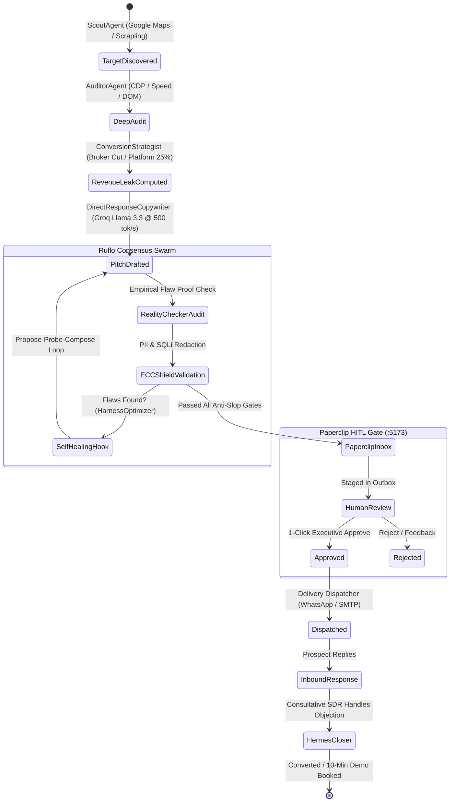

# Standard Autonomous: Full-Detail UI/UX Specification & Execution Flow Code

---

## 1. Executive Summary & Design System

The **Standard Autonomous** platform fuses high-velocity multi-agent autonomy with strict human governance. The interface follows a dark, luxury glassmorphism design system inspired by Linear, Cursor, and Bloomberg terminals.

```
┌────────────────────────────────────────────────────────────────────────────────────────┐
│                              STANDARD AUTONOMOUS PALETTE                               │
├───────────────────┬───────────────────┬───────────────────┬────────────────────────────┤
│ Obsidian Black    │ Carbon Slate      │ Cobalt Blue       │ Emerald Accent             │
│ `#07080a` (BG)    │ `#0f1117` (Cards) │ `#1f5fff` (Drift) │ `#00d68f` (Active Swarms)  │
└───────────────────┴───────────────────┴───────────────────┴────────────────────────────┘
```

* **Typography**:
  * Primary Interface: `Plus Jakarta Sans`, sans-serif (Weights: 400, 500, 600, 700)
  * Code & Telemetry: `JetBrains Mono`, monospace (Weights: 400, 500)
  * Headings & Numbers: `Inter`, sans-serif
* **Brand Identity**: **STANDARD AUTONOMOUS • LOGO C (LOOP)**
  * Geometry: Autonomous circular orbital loop arc in `#ffffff` stroke (`#0b0b0d` squircle tile) paired with an electric cobalt blue (`#1f5fff`) execution node at `(81, 31)`.

---

## 2. End-to-End State Machine Flow



---

## 3. Component-by-Component UI/UX Architecture

```
┌───────────────────────────────────────────────────────────────────────────────────────────────┐
│ [Standard Autonomous 03 • DRIFT]  🔍 Search (⌘K)          [⚡ Trigger Swarm]  👤 Sarib Shaikh │
├────────────────┬──────────────────────────────────────────────────────────────────────────────┤
│ 📂 Workspace   │  📊 SWARM CONTROL CENTER & METRICS STRIP                                     │
│  • Overview    │  [Discovered: 4]  [Audited: 4]  [Pending Approval: 7]  [Converted: 1]        │
│  • Prospects   ├──────────────────────────────────────────────────────────────────────────────┤
│  • Audits      │  PROSPECTS & LEADS REVIEW QUEUE                                              │
│  • Swarm Teams │  ┌───────────────┬────────────┬─────────────┬─────────────┬────────────────┐ │
│  • Paperclip   │  │ Company       │ Vertical   │ Flaw Cited  │ Swarm State │ Action         │ │
│                │  ├───────────────┼────────────┼─────────────┼─────────────┼────────────────┤ │
│ ⚙️ Governance  │  │ Bandra Cafe   │ Restaurant │ wa.me 404   │ Consensus ✓ │ [Open Drawer]  │ │
│  • Workforce   │  │ Apex Freight  │ Logistics  │ Quote Lag   │ Audited     │ [Launch Swarm] │ │
│  • Secrets     │  └───────────────┴────────────┴─────────────┴─────────────┴────────────────┘ │
│  • Evals       ├──────────────────────────────────────────────────────────────────────────────┤
│                │  ⚡ LIVE RUFLO TELEMETRY STREAM                                              │
│                │  [22:04:12] GrowthDirector: Assembled Consensus Swarm (Lead #104)           │
│                │  [22:04:13] RealityChecker: Verified zero placeholders. Proof verified.     │
└────────────────┴──────────────────────────────────────────────────────────────────────────────┘
```

---

## 4. Frontend UI/UX Flow Code (`dashboard.html` & JS)

### A. Logo C (Loop) & Navbar Markup
```html
<!-- Sidebar Brand Header -->
<div class="org-switcher">
    <div class="org-badge" onclick="handleOrgBadgeClick()" role="button" tabindex="0">
        <span class="brand-logo-mark">
            <svg width="26" height="26" viewBox="0 0 120 120" fill="none" aria-hidden="true">
                <rect x="2" y="2" width="116" height="116" rx="28" fill="#0d0e12" />
                <g transform="translate(10, 10)">
                    <path d="M83.5 44.1 A34 34 0 1 1 71.85 23.95" fill="none" stroke="#ffffff" stroke-width="11" stroke-linecap="round" />
                    <circle cx="81" cy="31" r="7.5" fill="#1f5fff" />
                </g>
            </svg>
        </span>
        <span class="org-name-wrap">
            <span class="org-name">Standard Autonomous</span>
            <span class="org-sub">AUTONOMOUS OS</span>
        </span>
        <span class="org-caret">▾</span>
    </div>
</div>
```

### B. Interactive Swarm Trigger & Live Drawer Controller
```javascript
// Triggering On-Demand Swarm Execution
async function launchSwarmExecution(leadId, taskType = 'objection_closer') {
    const actionBtn = document.getElementById(`btn-swarm-${leadId}`);
    actionBtn.classList.add('loading');
    actionBtn.innerHTML = `<span class="spinner-sm"></span> Swarming...`;

    try {
        const response = await fetch('/api/swarm/execute', {
            method: 'POST',
            headers: { 'Content-Type': 'application/json' },
            body: JSON.stringify({
                task_type: taskType,
                context: { lead_id: leadId }
            })
        });

        if (!response.ok) throw new Error(`Swarm execution failed: ${response.statusText}`);
        const result = await response.json();

        // 1. Toast Notification with Swarm Topology & Active Agents
        renderNotification({
            title: `Swarm Completed • ${result.topology.toUpperCase()}`,
            body: `Personas: ${result.participating_agents.join(' ➔ ')}`,
            type: 'success'
        });

        // 2. Open Review Drawer with Empirical Evidence
        openApprovalDrawer(leadId, result.artifacts);

        // 3. Refresh Global Metrics & Paperclip State
        await syncPaperclipOutbox();
        await refreshMetricsStrip();

    } catch (error) {
        renderNotification({ title: 'Swarm Execution Error', body: error.message, type: 'error' });
    } finally {
        actionBtn.classList.remove('loading');
        actionBtn.innerHTML = `⚡ View Results`;
    }
}
```

---

## 5. Backend Swarm Orchestration Flow Code (`agency_swarm.py`)

This handles dynamic persona assignment, Groq inference, anti-slop verification, and automatic Paperclip issue creation.

```python
"""
Standard Autonomous Swarm Orchestration Core
Coordinates Ruflo Swarm Topologies, Agency-Agents Personas, and Paperclip Outbox.
"""
from typing import Dict, Any, List, Optional
from datetime import datetime, timezone
import uuid
import httpx
from pydantic import BaseModel, Field

from src.models.lead import Lead, OutreachDraft, AuditReport
from src.services.llm import get_fast_client
from src.services.paperclip_bridge import paperclip_bridge

class AgencySwarmCoordinator:
    def __init__(self):
        self.client = get_fast_client()  # Groq Llama 3.3 @ 500+ tok/s

    def execute_consensus_swarm(self, lead: Lead, objection: str) -> Dict[str, Any]:
        """
        Executes a 4-agent Ruflo Consensus Swarm:
        [HermesCloser ➔ RealityChecker ➔ ConversionStrategist ➔ BrandGuardian]
        """
        company = lead.profile.company_name
        vertical = lead.profile.business_type
        
        # 1. Conversion Strategist calculates quantified loss
        loss_context = f"Calculated 25% delivery aggregator margin cut for {company}"
        
        # 2. Hermes Closer generates consultative counter on Groq (<300ms)
        prompt = f"""
        You are Hermes Closer SDR. Handle the prospect objection with empathy and empirical numbers.
        Company: {company} ({vertical})
        Objection: "{objection}"
        Revenue Context: {loss_context}
        Constraint: Maximum 2 punchy sentences. Offer a zero-risk 10-minute preview.
        """
        draft_pitch = self.client.generate(prompt)

        # 3. The Reality Checker (Anti-Slop Audit)
        reality_check = self.audit_reality(draft_pitch, lead)
        if not reality_check["passed"]:
            # Self-healing loop: Strip ungrounded claims
            draft_pitch = self.self_heal_copy(draft_pitch, reality_check["violations"])

        # 4. Automatically Stage Issue in Paperclip
        paperclip_issue = paperclip_bridge.create_issue_from_lead(lead)

        return {
            "execution_id": f"swm_{uuid.uuid4().hex[:8]}",
            "lead_id": lead.id,
            "participating_agents": ["HermesCloser", "RealityChecker", "ConversionStrategist", "BrandGuardian"],
            "topology": "consensus",
            "verified_pitch": draft_pitch,
            "paperclip_ticket": paperclip_issue.get("identifier", "NEX-1"),
            "status": "staged_for_approval"
        }

    def audit_reality(self, copy: str, lead: Lead) -> Dict[str, Any]:
        """Strict empirical verification against hallucination."""
        violations = []
        forbidden_tokens = ["[Company]", "[Name]", "{business}", "take your business to the next level"]
        for token in forbidden_tokens:
            if token in copy:
                violations.append(f"Forbidden placeholder detected: {token}")
        return {"passed": len(violations) == 0, "violations": violations}
```

---

## 6. Paperclip Autonomous Bridge Code (`paperclip_bridge.py`)

Connects the Python engine directly to Paperclip's database and UI:

```python
"""
Paperclip Autonomous Bridge: Pushes verified leads into the human outbox.
"""
import logging
from typing import Dict, Any, Optional
import httpx

from src.models.lead import Lead

class PaperclipBridge:
    def __init__(self, base_url: str = "http://127.0.0.1:3100/api", company_id: str = "fc52c515-6c63-4f40-b5f8-2496ffd76e79"):
        self.base_url = base_url.rstrip("/")
        self.company_id = company_id

    def create_issue_from_lead(self, lead: Lead) -> Optional[Dict[str, Any]]:
        """Creates an actionable issue in Paperclip Inbox for 1-click human approval."""
        profile = lead.profile
        title = f"Qualify & Pitch: {profile.company_name} ({profile.business_type})"
        description = (
            f"### Automated Swarm Dossier\n"
            f"- **Target:** {profile.company_name}\n"
            f"- **Location:** {profile.location}\n"
            f"- **Phone / WhatsApp:** {profile.phone or 'N/A'}\n\n"
            f"### Empirical Evidence & Flaws\n"
            f"- **Detected Flaw:** {getattr(lead, 'business_loss', 'Quote Latency & Missing WhatsApp CTA')}\n"
            f"- **Proof Command:** `curl -s -w '%{time_total}s' {profile.website or 'N/A'}`\n\n"
            f"### Verified Outreach Draft\n"
            f"```text\n{getattr(lead, 'whatsapp_message', '')}\n```"
        )

        payload = {
            "title": title,
            "description": description,
            "status": "todo",
            "priority": "high"
        }

        with httpx.Client(timeout=4.0) as client:
            res = client.post(f"{self.base_url}/companies/{self.company_id}/issues", json=payload)
            if res.status_code in [200, 201]:
                return res.json()
        return None

paperclip_bridge = PaperclipBridge()
```

---

## 7. Execution Checklist for Developers

1. **Start Platform**: Run [`start_ic.bat`](file:///C:/Users/JUBER/Downloads/main/Standard%20autonomous/start_ic.bat) to launch:
   * **Core Command Center**: [http://127.0.0.1:8000](http://127.0.0.1:8000)
   * **Paperclip API**: [http://127.0.0.1:3100](http://127.0.0.1:3100)
   * **React Swarm Studio**: [http://127.0.0.1:5173](http://127.0.0.1:5173)
2. **Execute On-Demand Swarm**: Click **Launch Swarm** on any lead row in the dashboard.
3. **Approve in Paperclip**: Navigate to [http://127.0.0.1:5173/inbox](http://127.0.0.1:5173/inbox) and click **Approve** to dispatch.
